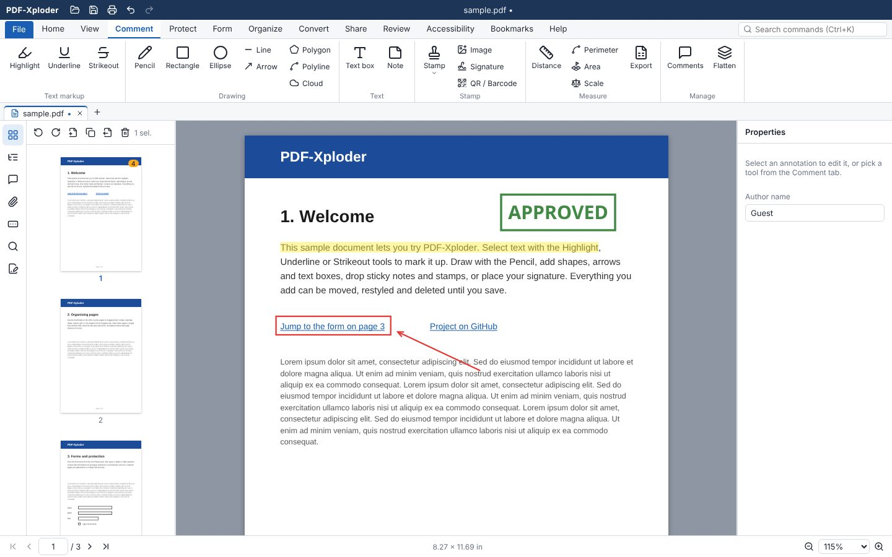

# PDF-Xploder – free PDF editor in your browser

[](https://stackoverbuffer.github.io/PDF-Xploder/)
[](https://github.com/StackOverBuffer/PDF-Xploder/actions/workflows/ci.yml)
[](https://github.com/StackOverBuffer/PDF-Xploder/actions/workflows/pages.yml)
[](LICENSE)

**PDF-Xploder** is a free, open-source PDF editor that runs entirely in your web browser. Annotate and highlight,
organise pages, fill and create forms, sign digitally, make scans searchable with OCR, redact and
password-protect PDFs – **without uploading your files anywhere**. No account, no installation, and
it keeps working offline. Its interface follows **PDF-XChange Editor** (ribbon, tools, dialogs), so it
feels familiar if you know desktop PDF editors like PDF-XChange or Adobe Acrobat.

**▶ [Open PDF-Xploder](https://stackoverbuffer.github.io/PDF-Xploder/)** · [auf Deutsch](https://stackoverbuffer.github.io/PDF-Xploder/?lang=de) · [Roadmap](ROADMAP.md)

<picture>
  <source media="(prefers-color-scheme: dark)" srcset="docs/screenshot-dark.jpg">
  
</picture>

## Features at a glance

- **Annotate PDFs**: highlight, underline, strikeout, pencil, shapes, arrows, clouds, text boxes, sticky notes, stamps, images and signatures – saved as standard PDF annotations that Acrobat and other viewers show and edit
- **Organise pages**: merge PDFs, split, insert, delete, extract, rotate, crop, reorder by drag and drop, drag pages between documents; watermarks, headers/footers, Bates numbering, page labels
- **Edit PDF content**: change existing text and images, add text, images and shapes, find and replace
- **Forms**: fill any PDF form, create and edit form fields
- **Sign and protect**: digital signatures with certificates (.p12/.pfx) and validation, AES-256 passwords and permissions, secure redaction (also search & redact)
- **OCR**: make scanned PDFs searchable or editable (German, English, French, Italian, Spanish, Dutch, Polish), with table and style recognition
- **Measure** distances, perimeters and areas on plans and drawings; add **QR codes and barcodes**
- **Comfortable**: tabs for several documents, command search (Ctrl+K), print dialog with N-up, dark theme, English and German, session restore, installable as an app that opens PDFs from your desktop

The full feature list, compared with PDF-XChange Editor, is in [ROADMAP.md](ROADMAP.md).

## Private by design

PDF-Xploder is a static web app: your PDFs are opened, edited and saved on your own device and are
never sent to a server. After the first visit the app works offline; installed (Chrome, Edge) it
gets its own window and appears under “Open with…” for PDF files.

## Auf Deutsch

PDF-Xploder ist ein **kostenloser Open-Source-PDF-Editor im Browser**: PDFs kommentieren und markieren, Seiten
zusammenführen, teilen, drehen und sortieren, Formulare ausfüllen und erstellen, digital signieren,
Scans per OCR durchsuchbar machen, schwärzen und mit Passwort schützen – ohne Upload, ohne Konto,
auch offline. Die Oberfläche ist vollständig auf Deutsch: [PDF-Xploder auf Deutsch öffnen](https://stackoverbuffer.github.io/PDF-Xploder/?lang=de).

## Development

```bash
npm install
npm run dev        # http://localhost:5173
npm test           # unit tests (geometry, PDF operations, …)
npm run build      # production build in dist/
```

Click **Try a sample** on the start screen for a document with text, a form and bookmarks.

### Offline and installation (service worker)

The production build includes a service worker (`pwa/sw.js`, filled in by the `pwa` plugin in
`vite.config.ts`) that caches every built file on the first visit, plus fonts and OCR data from
jsDelivr once they are used. A new version installs in the background and takes over once every
PDF-Xploder window has been closed. `public/manifest.webmanifest` makes the app installable and
registers it as a handler for PDF files. The service worker is not used by `npm run dev`.

### Publishing to GitHub Pages

`.github/workflows/pages.yml` builds the app and deploys it to GitHub Pages whenever the
repository's default branch is pushed (or when run manually from the Actions tab). One-time
setup: in the repository's **Settings → Pages**, set **Source** to **GitHub Actions**. The site
is then served at `https://<owner>.github.io/<repo>/`; the build picks up that sub-path through
the `BASE_PATH` environment variable (`BASE_PATH=/PDF-Xploder/ npm run build` reproduces it locally).

### Search engines and link previews

`index.html` carries the title, description, canonical URL (with an English and a German version,
`?lang=de`), Open Graph / Twitter card tags with `public/og-image.jpg` (1200×630) and schema.org
`WebApplication` data. `public/sitemap.xml` lists both language versions; GitHub Pages cannot serve a
`robots.txt` for a project page, so submit the sitemap in Google Search Console / Bing Webmaster Tools
instead. These files are left out of the offline cache.

## Architecture

| Layer | Where | What |
| --- | --- | --- |
| Rendering | `src/lib/pdfjs.ts`, `src/components/PageView.tsx` | [pdf.js](https://mozilla.github.io/pdf.js/) renders pages to canvas plus a selectable text layer. Pages are rendered lazily as they scroll into view. |
| Editing | `src/lib/pdfOps.ts` | [@cantoo/pdf-lib](https://github.com/cantoo-scribe/pdf-lib) (a maintained pdf-lib fork with encryption and incremental saving) implements every document change as `bytes → bytes`: page operations, watermarks, headers/footers, metadata, forms and annotation export. DOM-free and unit-tested. |
| Annotations I/O | `src/lib/appearance.ts`, `src/lib/annotIO.ts` | Every annotation gets an appearance stream. Saving writes native PDF annotations (`/Highlight`, `/Ink`, `/FreeText`, …); flattening paints the same appearance into the page. On open, supported annotations from any producer are imported for editing. |
| Fonts | `src/lib/fonts.ts`, `src/lib/subset.ts` | Added text uses a Noto fallback stack (Noto Sans and Symbols 2 bundled; CJK fetched on demand), subset with HarfBuzz `hb-subset` (WebAssembly). |
| Security | `src/lib/security.ts`, `src/lib/signature.ts`, `src/lib/der.ts` | AES-256/128 encryption and permissions; PKCS#7 digital signatures appended as incremental updates (signing via node-forge), verified with a small DER reader and Web Crypto. |
| State | `src/store/store.ts` | A zustand store holding the PDF bytes, a stable id per page and the annotations keyed by page id, so annotations follow their page through reorders. Every change pushes an immutable snapshot for undo/redo. |
| Commands | `src/store/commands.ts` | User-level actions (save, rotate, redact, …) that glue the UI, store and operations together. |
| Annotations | `src/components/AnnotationLayer.tsx` | An SVG overlay per page for drawing, selecting, moving and resizing annotations. |

Annotation geometry is stored in **PDF user space**. `src/lib/geometry.ts` maps it to the
rotated, scaled screen view and back, so annotations stay attached to content when pages are
rotated or cropped. Text, stamps, images and text markup also remember the page rotation they were
created at, and turn with the page like printed content would.

## Features in detail

What PDF-Xploder does today, by area. What is still missing, compared feature by feature with
PDF-XChange Editor, and what comes next is in [ROADMAP.md](ROADMAP.md).

### Ribbon
- PDF-XChange style ribbon: File, Home, View, Comment, Protect, Form, Organize, Convert, Share, Review, Accessibility, Bookmarks and Help tabs
- Command search (Ctrl+K) beside the ribbon tabs: type part of a command name in English or German ("rotate", "Wasserzeichen") and press Enter; lists every ribbon button and menu entry with its location, recently used commands first
- Home tab laid out like PDF-XChange: Tools (Hand, Select Text, Edit Comments, Snapshot/Clipboard/Find menus), View (zoom box with presets, 1:1, fit page/width, rotate view, pane toggles), Objects (Edit Text, Edit Objects, Add, Select)
- Big, small and icon buttons, split buttons with drop-down menus
- German and English interface (follows the browser language; switch under View → Interface, or open the app with `?lang=de` / `?lang=en`)
- Light and dark theme (View → Theme: same as system, light, dark); Preferences dialog; resizable side panes; the ribbon folds groups into drop-downs in narrow windows

### View & navigate
- Continuous scrolling, lazy page rendering, HiDPI canvases
- Zoom in/out, presets, fit width, fit page, Ctrl+wheel zoom
- Hand (pan), Select Text and Edit Comments tools, text selection & copy
- Snapshot tool: drag a box to copy that part of the page (with comments) to the clipboard as an image; copy/save a whole page as an image
- Attachments pane: list, save, add and remove embedded files
- Page thumbnails, bookmarks (outline) pane, comments pane
- Find text with match list, next/previous, match case, whole words, highlight all matches
- Find and replace in the page text (Home → Find → Find and replace…): replace the current match or all of them; the line is rewritten in its own font where it has the characters (Noto Sans otherwise). Matches within one line of text; text in comments, form fields or embedded graphics is not replaced
- Go to page, first/previous/next/last, keyboard shortcuts
- Rotate view (without changing the file); new comments follow the orientation on screen
- Clickable links (internal destinations, named actions, web links with confirmation)
- Several documents in tabs: each opened file gets its own tab with its own undo history, zoom and position; reorder by dragging, close with ×, middle click or the context menu (others / to the right / all); unsaved tabs are marked and confirmed before closing
- Drag pages between documents: drag thumbnails onto another tab (hovering switches to it) and drop them into its page list or onto the tab to append them; drop them on "+" to open them as a new document. Pages are copied with their comments, which stay editable

### Comment & markup
- Highlight, underline, strikeout from a text selection
- Pencil (freehand), rectangle, ellipse, line, arrow (Shift to constrain)
- Polygon, polyline and cloud (click the vertices, double-click to finish); clouds have scallops all along their edges, like revision clouds
- Text box (typewriter) with inline editing, sticky notes
- Stamps (Approved, Draft, Confidential, … or custom text); stamps made in other programs (e.g. PDF-XChange custom stamps) keep their own drawing and can be moved, resized and commented
- Pictures and signatures hang on the pointer like stamps and are placed with a click; they keep their proportions when resized (Shift: freely). Typed signatures in four bundled handwriting fonts
- Select, move, resize, restyle (colour, fill, thickness, opacity, font size), delete
- Selecting overlapping comments: the smaller one under the pointer comes first; click again on the same spot for the next one underneath (Alt+click: directly), right-click → Select lists everything there, Tab / Shift+Tab steps through the page's comments; thin lines and outlines are picked within a few pixels
- Comment text and author on every annotation; comments list
- Reply threads: replies made in PDF-XChange or Acrobat show under their comment (Comments pane, properties); add and delete replies; saved as standard replies (/IRT) that those programs show in the thread
- Saved as native, editable PDF annotations with appearance streams (or flattened on request)
- Import and edit annotations already present in a PDF (Highlight, Underline, Squiggly, StrikeOut, Ink, Square, Circle, Line, FreeText, Text, Redact), with lossless round trips of our own
- Measure tools (Comment → Measure): distance (M), perimeter and area with live values while drawing; drawing scale 1:n in mm/cm/m/km/in/ft/yd/mi, or calibrated from a measured line of known length; values shown on the page and in the properties; export as CSV; saved as standard PDF measurement annotations (/Measure, LineDimension / PolyLineDimension / PolygonDimension) that other viewers recognise
- QR codes (with error correction level) and barcodes (Code 128, EAN-13 with check digit), inserted like a stamp that hangs on the pointer until placed

### Organize pages
The **Organize** tab follows PDF-XChange Editor's *Dokumentaufbau* tab. Page commands act on the thumbnail selection (or the current page), and every dialog accepts ranges like `1-3, 5`.
- Insert blank pages (count, size, position), pages from another PDF (any range of it), images as pages, a page from a clipboard image; merge several files at a chosen position
- Delete pages (with odd/even subsets) and delete blank pages; extract pages (one file or one per page, optionally deleting them); move pages to a position
- Split by number of pages, into single pages, by page ranges, by top-level bookmarks or by maximum file size
- Duplicate pages (copies, collated or not, after each page / after the range / start / end), replace pages with pages of another file, swap two groups of pages, reverse the order of the selection or the document
- Overlay or underlay the pages of another PDF (first page on all, page by page, or repeating; fit, opacity), upright on rotated pages
- Find duplicate pages, by content (structural hash of content and resources) or by appearance (small renderings), then select or delete them
- Reorder by drag and drop in thumbnails (multi-select with Ctrl/Shift)
- Rotate pages (direction, odd/even, portrait/landscape only); crop pages or remove white margins automatically (from the rendered page)
- Resize pages to a paper size (scale the content or only change the page box, with an anchor), add margins, normalise pages (media box = crop box, bake the page rotation into the content, one common size); comments move with the content
- Watermarks (in front of or behind the content), backgrounds (colour and/or image), headers and footers at six positions, Bates numbering: all written as `/Artifact <</Type /Pagination /Subtype …>>` marked content, so *Remove* finds exactly these marks (and Acrobat's or PDF-XChange's)
- Page labels (*Seiten nummerieren*): ranges with decimal, roman or letter numbering, prefix and start number; shown in the status bar like PDF-XChange ("iv (4 / 20)")

### Edit content
- **Edit objects** tool (Edit tab) with an *All / Text / Images / Shapes* filter, like PDF-XChange's Edit Content tool: click to select, Shift/Ctrl+click or drag a marquee for several; overlapping objects: click again on the same spot (or Alt+click) for the one underneath, right-click → Select, Tab / Shift+Tab
- Move (drag, arrow keys; Shift = 10 pt / constrain), resize with handles (pictures keep their proportions, Shift resizes them freely; other objects keep them with Shift), rotate with the green handle (Shift snaps to 15°), rotate ±90°, flip, numeric position/size/rotation
- Arrange: bring to front/forward, send backward/to back; align left/centre/right/top/middle/bottom (to the selection, or to the page for one object); distribute; same width/height
- Edit existing text in place (double-click a line): the original font is kept when it has the characters, otherwise Noto Sans is used; change font, size, colour, character and word spacing, horizontal scale, baseline shift
- Shapes: fill and stroke colour (or none), line width; images: replace (scaled to the original's size), export any selection as a 300 dpi PNG; remove clipping paths; duplicate (Ctrl+D) and delete
- Add text, images, rectangles, ellipses and lines to the page content itself
- Add text boxes, images and signatures as comments; watermarks; headers/footers with page numbers, dates, title and Bates numbering
- Unicode text: Latin, Greek, Cyrillic, symbols and, when online, Chinese, Japanese and Korean

How it works: `src/lib/content/` parses the content stream, interprets it with a full graphics state and cuts it into objects (text lines, paths, images, form XObjects, shadings). Each object is written back as a self-contained `q … Q` block carrying its own CTM, clipping paths, graphics state and marked content, so it can be changed independently. Before the first edit of a page the app rewrites it without changes and compares renderings; if it cannot reproduce the page exactly it asks before editing.

### Forms
- Fill text fields, checkboxes, radio buttons, dropdowns and list boxes directly on the page or in the Form fields pane (undoable, saved with the document; Unicode values supported)
- Highlight fillable fields, flatten forms
- Form design: create text fields, check boxes, radio buttons, dropdowns and list boxes; move, resize, rename and delete fields
- Field properties: read only, required, value locked, excluded from export, **locked** (no moving, resizing, deleting or changing until unlocked), visibility (hidden, no-print, print-only), tooltip; text alignment, font size, max length, multi-line, password, comb, scrolling, spell checking; choice options, custom text, sorting, multiple selection

### Protect & sign
- Secure redaction: marked pages are flattened and rasterised so the underlying text and graphics are really removed
- Visual (image) signatures
- Password protection: open password, permissions password, AES-256 or AES-128
- Permissions: printing (none / low / high resolution), changing the document, page assembly, commenting, form filling, copying, accessibility; presets and a summary of the restrictions in effect
- Permissions are enforced action by action for documents opened without the owner password; allowed edits are saved with the original encryption, so the owner password and restrictions are preserved. The owner password lifts the restrictions
- Certificate-based digital signatures (PKCS#7 detached, SHA-256) from .p12/.pfx files, visible or invisible, as incremental updates so earlier signatures stay valid; self-signed test certificates can be created in the app
- Signature validation: integrity, signature (RSA and ECDSA) and coverage; signer, issuer, time, reason
- *Limitation:* Signer identity is not checked against trusted certificates (no trust list, revocation or timestamp checks yet)
- Search & redact (Protect → Redaction): mark every match of a search for redaction, with boxes that fit the words exactly, then apply

### Document & output
- New blank document, open (picker or drag & drop), save, save as, save flattened copy, print
- Print dialog with preview: page range, odd/even pages, reverse order, with or without comments, paper size and orientation, margins, fit/shrink/actual/custom scaling, 2–16 pages per sheet with page borders
- Save writes back to the opened file in Chrome and Edge (File System Access API; the browser asks once for write access), Save As shows a save dialog there; other browsers download the file
- Install as an app (File → Install app, in Chrome and Edge): own window, works fully offline, and appears under "Open with…" for PDF files; files opened that way arrive as tabs in the running window
- Unchanged documents are saved byte-for-byte (signatures and encryption stay intact)
- Document properties (title, author, subject, keywords, creator, producer)
- Export the current page as PNG
- OCR for scanned documents (see below)
- Share the PDF via the system share sheet (where the browser supports it)
- Accessibility: quick check (tags, language, title, text, field tooltips, permissions) with one-click fixes; read aloud; inverted page colours
- Restore session and autosave: the open tabs, with unsaved changes, are kept in this browser (IndexedDB) a moment after each change and reopen at the next start, at the same page; File → Session → Restore session turns it off (and deletes what was kept). Password-protected documents are not kept. Recent files on the start screen and under File → Recent (reopened directly in Chrome and Edge)

### OCR
- **OCR Pages** dialog like PDF-XChange's Enhanced OCR plugin: all / current / a range of pages; German, English, French, Italian, Spanish, Dutch and Polish (any combination); 150–400 dpi; pages that already contain text are skipped unless asked
- Output types: **Searchable Image** (page unchanged, invisible text scaled to each word), **Editable Text and Images** (visible, editable text in a font matching the recognised style, table lines as vector lines, the recognised text and lines painted out of the page image in their local background colour) and **Fine Page Content** (only text, lines and images of picture regions on a white page)
- Text style recognition from the pixels of each word: colour, bold (stroke width), italic (stroke slant), underline and strikeout, serif / sans-serif / monospaced; Helvetica, Times and Courier with bold/italic variants, Noto Sans for characters outside WinAnsi
- Table recognition: ruling lines and cell grids (with merged cells); lines are removed before recognition so they do not turn into characters
- Detects (and optionally corrects) image skew up to ±15° and wrong page rotation (90°/180°/270°, corrected through the page's rotation)
- Multi-threaded: several Tesseract workers recognise pages in parallel, with per-page progress and cancel
- *Limitation:* Style recognition is heuristic: bold serif text is often taken for sans-serif, and very small text (< 8 pt at 150 dpi) gives unreliable bold/italic results

How it works: tesseract.js 7 (LSTM engine, WebAssembly) is loaded on demand; its worker, core and language data (`best_int` models) are fetched from jsDelivr with pinned versions (see `src/lib/ocr/config.ts`). Everything else is in `src/lib/ocr/`: skew and orientation detection by projection profiles, ruling-line and picture detection, style measurements, and the writers for the three output types.

## Notes

- **Fonts.** Noto Sans, Noto Sans Symbols 2 (bundled in `public/fonts`) and Noto Sans SC/KR (fetched from jsDelivr only when text needs them) are licensed under the SIL Open Font License; see `public/fonts/OFL.txt`. Once loaded they are cached for offline use; offline before the first use, CJK characters fall back to `?`.
- **node-forge.** `npm audit` flags node-forge for GHSA-86w9-cpqp-85rv, a flaw in its RSA signature *verification*. The app uses forge only to read .p12 files and create signatures; all verification goes through Web Crypto.
- **Permissions.** PDF permissions are honoured by well-behaved software, not enforced cryptographically, and PDF has no permission that prevents saving a copy. To re-encrypt a restricted file without its owner password, the app derives the file key through an internal module of `@cantoo/pdf-lib` (aliased as `pdf-lib-internal/crypto` in `vite.config.ts`). For documents you are entitled to edit, *Protect → Unlock → Lift restrictions without the password…* lifts them for the session after you confirm that; saving keeps the original encryption and restrictions unless you change the security.
- **Saving signed documents.** Edits to a signed document are saved by rewriting the file, which invalidates existing signatures (the app asks first). Sign again after editing.

## Keyboard shortcuts

`Ctrl+K` search commands · `Ctrl+O` open · `Ctrl+Alt+PgDn`/`Ctrl+Alt+PgUp` next/previous tab · `Ctrl+S` save · `Ctrl+P` print · `Ctrl+Z`/`Ctrl+Y` undo/redo · `Ctrl+F` find ·
`Ctrl+G` go to page · `Ctrl +/-/0` zoom · `Del` delete selection · `Esc` select tool ·
`Alt+PgDn`/`Alt+PgUp` next/previous bookmark · `V` edit comments · `X` select text · `G` snapshot · `H` hand · `Shift+H` highlight · `U` underline · `K` strikeout · `P` pencil ·
`R` rectangle · `O` ellipse · `L` line · `A` arrow · `T` text box · `N` note · `S` stamp

Edit objects tool: arrow keys nudge (Shift ×10) · `Del` delete · `Ctrl+D` duplicate · `Ctrl+A` select all on the page · double-click text to edit · `Esc` deselect

## License

PDF-Xploder is free software: you can redistribute it and/or modify it under the terms of the
[GNU Affero General Public License](LICENSE) as published by the Free Software Foundation, either
version 3 of the License, or (at your option) any later version. It is distributed in the hope that
it will be useful, but WITHOUT ANY WARRANTY; without even the implied warranty of MERCHANTABILITY or
FITNESS FOR A PARTICULAR PURPOSE. See the license for details.

Copyright (C) 2026 the PDF-Xploder contributors.

**Running a modified version as a website?** The AGPL asks you to offer its users the source code of
your version: point `SOURCE_URL` in `src/lib/project.ts` (shown on the start screen and under
Help → Source code) to your modified source.

Bundled and loaded third-party components keep their own licenses: pdf.js and tesseract.js
(Apache-2.0), pdf-lib, fontkit, HarfBuzz.js, qrcode-generator, React and zustand (MIT), Lucide (ISC),
node-forge (used under BSD-3-Clause) and the Noto fonts (SIL Open Font License, `public/fonts/OFL.txt`).
